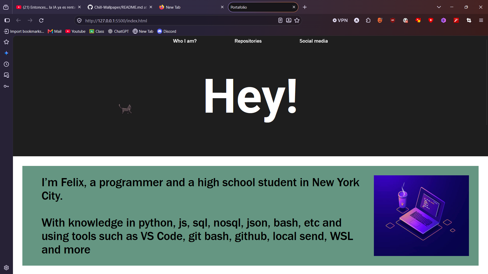

# My First Portfolio

A small website built with HTML, CSS, and JavaScript to showcase my portfolio.

## Requirements

To view this project, simply visit the [GitHub Pages website](https://k0l1-hub.github.io/My-first-portafolio/).

## What's Included

* Skills
* Likes
* Latest repository
* Contact information

## AI Usage

AI is only used to help identify potential errors. All code is written by humans.

## Contributions

I'm not very creative when it comes to web design, so feel free to suggest improvements or redesign parts of the website!

## License

This project is licensed under the **MIT License**. Anyone is free to use, modify, distribute, and even sell software incorporating this project, subject to the license terms.

# :D
